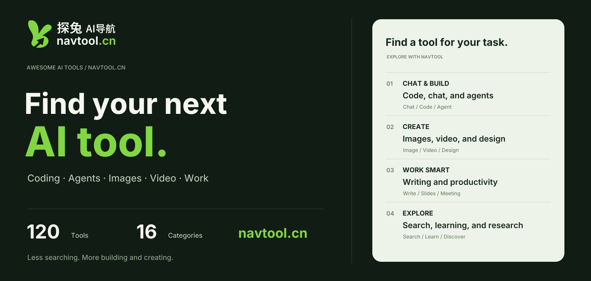
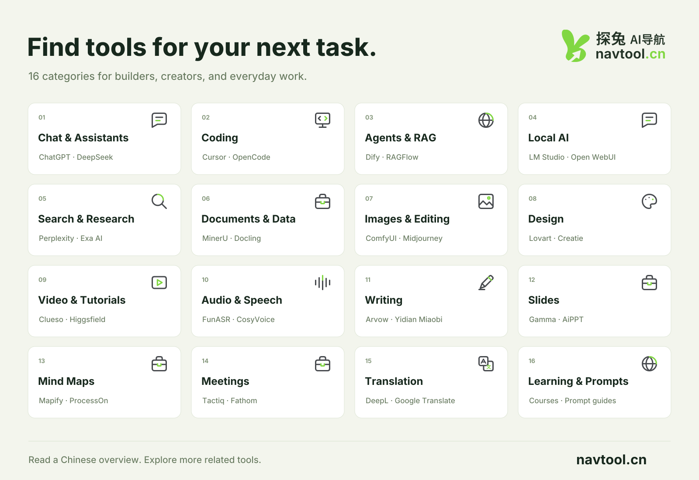
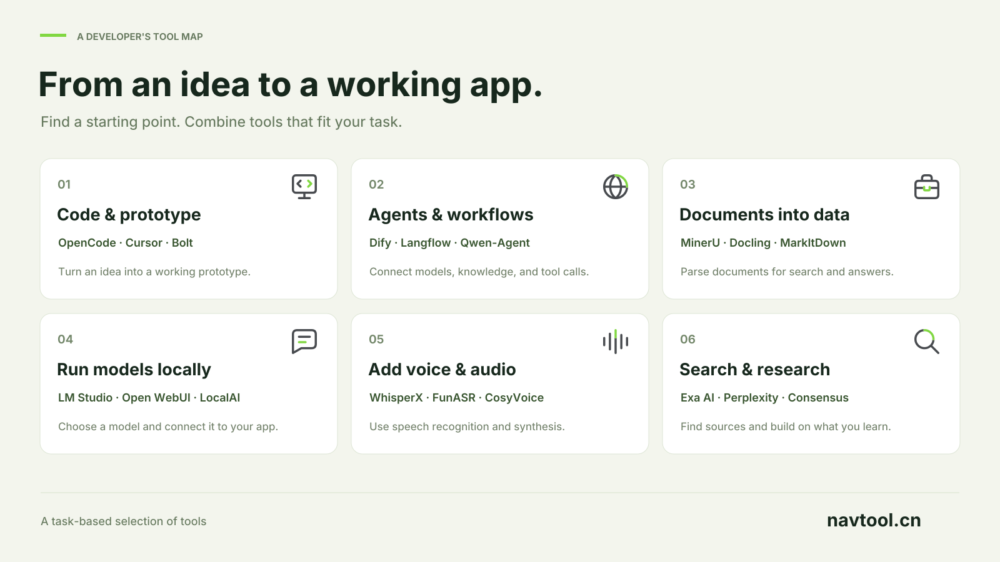
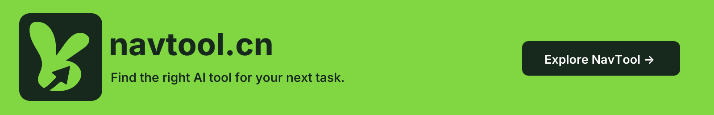

<h1 align="center">Awesome AI Tools</h1>

  <a href="https://www.navtool.cn/"><strong>NavTool AI · navtool.cn</strong></a>

Find the right AI tool for your next task.

Chat · Coding · Agents · Images · Video · Productivity · Learning

<a href="README.md">简体中文</a> · <strong>English</strong>

  
  
   
  
  

  <a href="https://www.navtool.cn/"><strong>Browse NavTool →</strong></a>
   
  <a href="#start-here">Start here</a> ·
  <a href="#directory">Categories</a> ·
  <a href="CONTRIBUTING.en.md">Contribute</a>

**Start with the job you want to get done.**

A curated AI tools collection by [NavTool AI (探兔AI导航)](https://www.navtool.cn/) for developers, designers, creators, and everyday work. Every entry has a short description, a Chinese overview on NavTool, and a direct product or project link.

**120 curated tools · 16 categories · Updated October 19, 2026**

---

## 🐰 Explore more with NavTool AI

Looking for alternatives, a Chinese overview, or more tools for the same task? Explore **[navtool.cn →](https://www.navtool.cn/)**. The website is primarily in Chinese.

| What you can do on NavTool | Explore online |
| --- | --- |
| Browse tools by task and compare related options | [Coding](https://www.navtool.cn/tools/ai_programming_tools) · [AI development](https://www.navtool.cn/tools/ai_development_platform) |
| Find tools for content creation and everyday work | [Images](https://www.navtool.cn/tools/ai_image_tools) · [Writing](https://www.navtool.cn/tools/ai_writer_tools) · [Productivity](https://www.navtool.cn/tools/ai_office_tools) |
| Read AI news and browse on-site rankings | [AI news](https://www.navtool.cn/news) · [Rankings](https://www.navtool.cn/rankings) |
| Recommend a tool or introduce your own product | [Submit a tool](https://www.navtool.cn/contribute) · [Contact](https://www.navtool.cn/contact) |

> Bookmark [navtool.cn](https://www.navtool.cn/) · Windows / Linux: `Ctrl + D` · Mac: `⌘ + D`

## ⭐ Start here

Pick a task, then try one or two tools. Tool names open a Chinese overview on NavTool.

| I want to… | Start with | Explore |
| --- | --- | --- |
| Ask questions and create content | [ChatGPT](https://www.navtool.cn/tool/567.html) · [DeepSeek](https://www.navtool.cn/tool/565.html) | [Chat](#tools-chat) |
| Understand or modify a codebase | [Cursor](https://www.navtool.cn/tool/807.html) · [OpenCode](https://www.navtool.cn/tool/2204.html) | [Coding](#tools-coding) |
| Build an agent or knowledge base | [Dify](https://www.navtool.cn/tool/2106.html) · [RAGFlow](https://www.navtool.cn/tool/2094.html) | [Agents & RAG](#tools-agents) |
| Try models on my own computer | [LM Studio](https://www.navtool.cn/tool/2077.html) · [Open WebUI](https://www.navtool.cn/tool/2064.html) | [Local AI](#tools-local-ai) |
| Create images and visual assets | [Midjourney](https://www.navtool.cn/tool/245.html) · [ComfyUI](https://www.navtool.cn/tool/2186.html) | [Images](#tools-image) |
| Prepare slides and organize ideas | [Gamma](https://www.navtool.cn/tool/58.html) · [Mapify](https://www.navtool.cn/tool/114.html) | [Slides](#tools-slides) |

## 🗂️ Categories

Jump to a category below. Counts refer to the curated entries in this repository.

| Development & Models | Images & Content | Work & Collaboration | Information & Learning |
| --- | --- | --- | --- |
| [Chat](#tools-chat) 8 | [Images](#tools-image) 8 | [Writing](#tools-writing) 6 | [Search](#tools-search) 8 |
| [Coding](#tools-coding) 10 | [Design](#tools-design) 8 | [Slides](#tools-slides) 6 | [Documents](#tools-documents) 8 |
| [Agents & RAG](#tools-agents) 8 | [Video](#tools-video) 8 | [Mind Maps](#tools-mindmap) 6 | [Translation](#tools-translation) 6 |
| [Local AI](#tools-local-ai) 8 | [Audio](#tools-audio) 10 | [Meetings](#tools-meetings) 6 | [Learning](#tools-learning) 6 |

Show the 16-category tool map

---

## The complete curated list

Tool names open their Chinese overview on NavTool. Visit opens the product or project directly. Each section also links to more related tools on the website.

### 01. Chat & AI Assistants (8)

Find an assistant for questions, writing, and working with information.

| Tool / Overview | What it helps with | Link |
| --- | --- | --- |
| [ChatGPT](https://www.navtool.cn/tool/567.html) | Ask questions, create content, and analyze information through conversation. | [Visit](https://chatgpt.com) |
| [DeepSeek](https://www.navtool.cn/tool/565.html) | Get help with everyday questions, reasoning, and programming. | [Visit](https://www.deepseek.com) |
| [Kimi](https://www.navtool.cn/tool/633.html) | Read documents, search for information, and create content in conversation. | [Visit](https://www.kimi.com) |
| [Doubao](https://www.navtool.cn/tool/627.html) | Handle everyday questions and multimodal content creation. | [Visit](https://www.doubao.com/chat) |
| [Qwen](https://www.navtool.cn/tool/623.html) | Ask questions and generate content with a conversational assistant. | [Visit](https://tongyi.aliyun.com) |
| [Tencent Yuanbao](https://www.navtool.cn/tool/625.html) | Combine conversation and search for research and content work. | [Visit](https://yuanbao.tencent.com) |
| [iFLYTEK Spark](https://www.navtool.cn/tool/629.html) | Get assistance with questions, content creation, and office tasks. | [Visit](https://xinghuo.xfyun.cn) |
| [Grok](https://www.navtool.cn/tool/605.html) | Ask questions, create content, and explore information through chat. | [Visit](https://grok.com) |

[More related tools on NavTool →](https://www.navtool.cn/tools/ai_dialog_tools) · [Back to categories ↑](#directory)

### 02. AI Coding & App Builders (10)

Write code, understand a codebase, or turn an idea into a working prototype.

| Tool / Overview | What it helps with | Link |
| --- | --- | --- |
| [OpenCode](https://www.navtool.cn/tool/2204.html) | Work on programming tasks in a terminal or development environment. | [Visit](https://opencode.ai) |
| [CodeBuddy](https://www.navtool.cn/tool/2114.html) | Get code completion and assistance with development tasks. | [Visit](https://www.codebuddy.cn) |
| [Cursor](https://www.navtool.cn/tool/807.html) | Understand, write, and modify code inside an editor. | [Visit](https://cursor.com) |
| [Windsurf](https://www.navtool.cn/tool/845.html) | Use an integrated development environment with AI assistance. | [Visit](https://windsurf.com) |
| [Bolt](https://www.navtool.cn/tool/843.html) | Build web applications from natural-language instructions. | [Visit](https://bolt.new) |
| [Replit Agent](https://www.navtool.cn/tool/841.html) | Build and iterate on applications through conversation. | [Visit](https://docs.replit.com/replitai/agent) |
| [Wegic](https://www.navtool.cn/tool/853.html) | Design and build websites through a conversational workflow. | [Visit](https://wegic.ai) |
| [BLACKBOX AI](https://www.navtool.cn/tool/847.html) | Get help generating, understanding, and modifying code. | [Visit](https://www.blackbox.ai) |
| [Baidu Comate](https://www.navtool.cn/tool/849.html) | Get assistance with code completion and programming tasks. | [Visit](https://comate.baidu.com) |
| [CodeArts Snap](https://www.navtool.cn/tool/851.html) | Add intelligent coding assistance to a development workflow. | [Visit](https://www.huaweicloud.com/product/codeartside/snap.html) |

[More related tools on NavTool →](https://www.navtool.cn/tools/ai_programming_tools) · [Back to categories ↑](#directory)

### 03. Agents, Workflows & RAG (8)

Connect models, documents, tools, and application workflows.

| Tool / Overview | What it helps with | Link |
| --- | --- | --- |
| [Dify](https://www.navtool.cn/tool/2106.html) | Build AI applications, workflows, and knowledge bases. | [Visit](https://dify.ai) |
| [FastGPT](https://www.navtool.cn/tool/2090.html) | Build knowledge-base question answering and AI workflows. | [Visit](https://fastgpt.cn) |
| [RAGFlow](https://www.navtool.cn/tool/2094.html) | Build retrieval-augmented applications from documents. | [Visit](https://ragflow.io) |
| [Langflow](https://www.navtool.cn/tool/2132.html) | Compose AI applications with visual components. | [Visit](https://www.langflow.org) |
| [Qwen-Agent](https://www.navtool.cn/tool/2183.html) | Develop agents that can call tools. | [Visit](https://github.com/QwenLM/Qwen-Agent) |
| [Relevance AI](https://www.navtool.cn/tool/2286.html) | Build AI agents for business workflows. | [Visit](https://relevanceai.com) |
| [Lindy](https://www.navtool.cn/tool/2254.html) | Connect work applications and automate routine workflows. | [Visit](https://www.lindy.ai) |
| [DeerFlow](https://www.navtool.cn/tool/2216.html) | Explore an agent framework for research, coding, and content tasks. | [Visit](https://deerflow.tech) |

[More related tools on NavTool →](https://www.navtool.cn/tools/ai_development_platform) · [Back to categories ↑](#directory)

### 04. Local AI & Chat Clients (8)

Run models locally or manage several model providers in one place.

| Tool / Overview | What it helps with | Link |
| --- | --- | --- |
| [LM Studio](https://www.navtool.cn/tool/2077.html) | Download, run, and call local models from a desktop application. | [Visit](https://lmstudio.ai) |
| [GPT4All](https://www.navtool.cn/tool/2097.html) | Run conversational models and document question answering locally. | [Visit](https://www.nomic.ai/gpt4all) |
| [Open WebUI](https://www.navtool.cn/tool/2064.html) | Set up a web workspace for model chat and knowledge bases. | [Visit](https://openwebui.com) |
| [AnythingLLM](https://www.navtool.cn/tool/2068.html) | Connect documents to an AI assistant and knowledge base. | [Visit](https://anythingllm.com) |
| [Cherry Studio](https://www.navtool.cn/tool/2061.html) | Use multiple model providers from one desktop client. | [Visit](https://www.cherryai.com.cn) |
| [LocalAI](https://www.navtool.cn/tool/2152.html) | Expose local models through application-compatible inference APIs. | [Visit](https://localai.io) |
| [KoboldCpp](https://www.navtool.cn/tool/2222.html) | Run GGUF models locally with a web interface. | [Visit](https://github.com/LostRuins/koboldcpp) |
| [Khoj](https://www.navtool.cn/tool/2149.html) | Search and ask questions about personal notes and documents. | [Visit](https://khoj.dev) |

[More related tools on NavTool →](https://www.navtool.cn/tools/ai_dialog_tools) · [Back to categories ↑](#directory)

### 05. AI Search & Research (8)

Search for information and research leads, then check the original sources.

| Tool / Overview | What it helps with | Link |
| --- | --- | --- |
| [Perplexity](https://www.navtool.cn/tool/1167.html) | Search for information with AI-assisted answers. | [Visit](https://www.perplexity.ai) |
| [Exa AI](https://www.navtool.cn/tool/1183.html) | Add web search and information retrieval to applications. | [Visit](https://exa.ai) |
| [Consensus](https://www.navtool.cn/tool/1153.html) | Search for information in scientific literature. | [Visit](https://consensus.app) |
| [Phind](https://www.navtool.cn/tool/1157.html) | Find information through AI search and question answering. | [Visit](https://www.phind.com) |
| [Felo](https://www.navtool.cn/tool/1185.html) | Search and organize information with natural-language queries. | [Visit](https://felo.ai/search) |
| [Genspark](https://www.navtool.cn/tool/1181.html) | Get assistance with information search, research, and synthesis. | [Visit](https://www.genspark.ai) |
| [Zhihu Zhida](https://www.navtool.cn/tool/1165.html) | Find and organize knowledge through question answering. | [Visit](https://zhida.zhihu.com) |
| [Glean](https://www.navtool.cn/tool/1175.html) | Search and connect information across enterprise work systems. | [Visit](https://www.glean.com) |

[More related tools on NavTool →](https://www.navtool.cn/tools/ai_se) · [Back to categories ↑](#directory)

### 06. Documents & Data (8)

Parse documents and prepare information for analysis, knowledge management, and RAG.

| Tool / Overview | What it helps with | Link |
| --- | --- | --- |
| [MinerU](https://www.navtool.cn/tool/2074.html) | Parse documents into structured content for retrieval. | [Visit](https://mineru.net) |
| [Docling](https://www.navtool.cn/tool/2120.html) | Convert PDFs, Office files, and scans into structured content. | [Visit](https://docling.ai) |
| [MarkItDown](https://www.navtool.cn/tool/2180.html) | Convert common file formats into Markdown. | [Visit](https://github.com/microsoft/markitdown) |
| [PaddleOCR](https://www.navtool.cn/tool/2129.html) | Extract text, tables, and layout information from images and documents. | [Visit](https://www.paddleocr.ai) |
| [Xiaohuanxiong](https://www.navtool.cn/tool/1195.html) | Get assistance processing and analyzing data files. | [Visit](https://www.xiaohuanxiong.com) |
| [Gigasheet](https://www.navtool.cn/tool/1670.html) | Process and analyze data in a spreadsheet-style interface. | [Visit](https://www.gigasheet.com) |
| [Scribe](https://www.navtool.cn/tool/2443.html) | Turn a sequence of actions into a screenshot-based process guide. | [Visit](https://scribe.com) |
| [Open Notebook](https://www.navtool.cn/tool/2201.html) | Organize source material and ask research questions with references. | [Visit](https://www.open-notebook.ai) |

[More related tools on NavTool →](https://www.navtool.cn/tools/ai_documentation_tool) · [Back to categories ↑](#directory)

### 07. AI Images & Editing (8)

Explore image generation, editing, and product-image workflows.

| Tool / Overview | What it helps with | Link |
| --- | --- | --- |
| [Stable Diffusion](https://www.navtool.cn/tool/249.html) | Explore text-to-image models and generation tools. | [Visit](https://stability.ai) |
| [Midjourney](https://www.navtool.cn/tool/245.html) | Create images from text prompts. | [Visit](https://www.midjourney.com) |
| [ComfyUI](https://www.navtool.cn/tool/2186.html) | Compose image and video generation with node-based workflows. | [Visit](https://comfy.org) |
| [Gaoding AI](https://www.navtool.cn/tool/1786.html) | Create visual ideas and design assets with AI assistance. | [Visit](https://www.gaoding.art) |
| [MoPNG](https://www.navtool.cn/tool/1843.html) | Edit images, remove backgrounds, and adjust image dimensions. | [Visit](https://mopng.cn) |
| [PicDoc](https://www.navtool.cn/tool/1787.html) | Turn written content into diagrams and visual explanations. | [Visit](https://www.picdoc.cn) |
| [BeePOP](https://www.navtool.cn/tool/2016.html) | Create ecommerce listing images from product assets. | [Visit](https://beepop.net/) |
| [Imgkits](https://www.navtool.cn/tool/2334.html) | Edit and process images with online tools. | [Visit](https://imgkits.com) |

[More related tools on NavTool →](https://www.navtool.cn/tools/ai_image_tools) · [Back to categories ↑](#directory)

### 08. AI Design & Visual Creation (8)

Find tools for interfaces, branding, diagrams, and 3D concepts.

| Tool / Overview | What it helps with | Link |
| --- | --- | --- |
| [Napkin AI](https://www.navtool.cn/tool/1951.html) | Turn text into diagrams and infographics. | [Visit](https://www.napkin.ai) |
| [Creatie](https://www.navtool.cn/tool/964.html) | Get assistance with product interfaces and visual design. | [Visit](https://creatie.ai) |
| [Lovart](https://www.navtool.cn/tool/1677.html) | Work on a range of visual design tasks with AI assistance. | [Visit](https://www.lovart.ai) |
| [Framer AI](https://www.navtool.cn/tool/960.html) | Get assistance designing and building website pages. | [Visit](https://www.framer.com/ai) |
| [Spline AI](https://www.navtool.cn/tool/952.html) | Create and explore 3D scenes and visual concepts. | [Visit](https://spline.design/ai-generate) |
| [Looka](https://www.navtool.cn/tool/966.html) | Create logo and brand-identity concepts. | [Visit](https://looka.com) |
| [FigJam AI](https://www.navtool.cn/tool/950.html) | Organize ideas and collaborative content on a whiteboard. | [Visit](https://www.figma.com/figjam/ai) |
| [Vizcom](https://www.navtool.cn/tool/958.html) | Turn design sketches into visual concepts. | [Visit](https://www.vizcom.com) |

[More related tools on NavTool →](https://www.navtool.cn/tools/ai_design_tools) · [Back to categories ↑](#directory)

### 09. AI Video & Tutorials (8)

Create visual content, record tutorials, or add video understanding to an application.

| Tool / Overview | What it helps with | Link |
| --- | --- | --- |
| [Clueso](https://www.navtool.cn/tool/2446.html) | Turn recordings or source material into tutorial videos and documents. | [Visit](https://www.clueso.io) |
| [Guidde](https://www.navtool.cn/tool/2399.html) | Turn software recordings into step-by-step video tutorials. | [Visit](https://www.guidde.com) |
| [Higgsfield AI](https://www.navtool.cn/tool/2397.html) | Create AI images, videos, and visual effects. | [Visit](https://higgsfield.ai) |
| [LightX2V Studio](https://www.navtool.cn/tool/2266.html) | Organize video and avatar assets through creative workflows. | [Visit](https://x2v.light-ai.top/) |
| [Riverside](https://www.navtool.cn/tool/2425.html) | Record remote audio and video, then edit the resulting content. | [Visit](https://riverside.com) |
| [Twelve Labs](https://www.navtool.cn/tool/1949.html) | Add video search, understanding, and analysis to applications. | [Visit](https://www.twelvelabs.io) |
| [Wondershare Filmora](https://www.navtool.cn/tool/1796.html) | Edit videos and produce visual content. | [Visit](https://miao.wondershare.cn) |
| [Kaipai](https://www.navtool.cn/tool/1596.html) | Get assistance creating and editing short-form videos. | [Visit](https://www.kaipai.com) |

[More related tools on NavTool →](https://www.navtool.cn/tools/ai_video_tools) · [Back to categories ↑](#directory)

### 10. AI Audio & Speech (10)

Explore transcription, speech synthesis, voice input, and music creation.

| Tool / Overview | What it helps with | Link |
| --- | --- | --- |
| [WhisperX](https://www.navtool.cn/tool/2171.html) | Transcribe speech and align words with timestamps. | [Visit](https://github.com/m-bain/whisperX) |
| [FunASR](https://www.navtool.cn/tool/2146.html) | Develop speech recognition and streaming transcription applications. | [Visit](https://www.funasr.com) |
| [SenseVoice](https://www.navtool.cn/tool/2198.html) | Recognize multilingual speech and audio events. | [Visit](https://github.com/QwenAudio/SenseVoice) |
| [CosyVoice](https://www.navtool.cn/tool/2230.html) | Develop multilingual text-to-speech and streaming speech generation. | [Visit](https://github.com/QwenAudio/CosyVoice) |
| [GPT-SoVITS](https://www.navtool.cn/tool/2233.html) | Explore speech synthesis and few-shot voice cloning. | [Visit](https://github.com/RVC-Boss/GPT-SoVITS) |
| [WhisperLive](https://www.navtool.cn/tool/2236.html) | Transcribe microphones, recordings, and audio streams in near real time. | [Visit](https://github.com/collabora/WhisperLive) |
| [Wispr Flow](https://www.navtool.cn/tool/2395.html) | Turn spoken input into editable text. | [Visit](https://wisprflow.ai) |
| [Krisp](https://www.navtool.cn/tool/2307.html) | Reduce audio noise and generate meeting transcripts and summaries. | [Visit](https://krisp.ai) |
| [Vapi](https://www.navtool.cn/tool/1950.html) | Build voice agents for applications. | [Visit](https://vapi.ai) |
| [Sonauto](https://www.navtool.cn/tool/1114.html) | Generate music and explore audio creation. | [Visit](https://sonauto.ai) |

[More related tools on NavTool →](https://www.navtool.cn/tools/ai_audio_tools) · [Back to categories ↑](#directory)

### 11. AI Writing & Content (6)

Draft articles, proposals, and work documents, then review and refine the result.

| Tool / Overview | What it helps with | Link |
| --- | --- | --- |
| [Arvow](https://www.navtool.cn/tool/2046.html) | Work on SEO article creation and publishing workflows. | [Visit](https://arvow.com) |
| [Qiaowenshu AI](https://www.navtool.cn/tool/1997.html) | Draft proposals and tender documents with AI assistance. | [Visit](https://qiaowenshu.cn/index) |
| [Yidian Miaobi](https://www.navtool.cn/tool/1981.html) | Draft formal work documents with AI assistance. | [Visit](https://www.1dmiaobi.com) |
| [Cailiaoxing](https://www.navtool.cn/tool/1965.html) | Draft, revise, and format workplace documents. | [Visit](https://www.cailiaoxing.com) |
| [Gongwenbao](https://www.navtool.cn/tool/1762.html) | Draft and organize formal work documents. | [Visit](https://www.gwb666.com) |
| [Copy2AI](https://www.navtool.cn/tool/1697.html) | Create content for different scenarios and generate drafts in batches. | [Visit](https://www.copy2ai.com/creator.html) |

[More related tools on NavTool →](https://www.navtool.cn/tools/ai_writer_tools) · [Back to categories ↑](#directory)

### 12. AI Slides & Presentations (6)

Turn an outline or a collection of notes into a presentation.

| Tool / Overview | What it helps with | Link |
| --- | --- | --- |
| [Gamma](https://www.navtool.cn/tool/58.html) | Generate and edit presentation content. | [Visit](https://gamma.app) |
| [AiPPT](https://www.navtool.cn/tool/1216.html) | Generate presentations from topics and source material. | [Visit](https://www.aippt.cn) |
| [WPS AI](https://www.navtool.cn/tool/1191.html) | Get AI assistance with office content and documents. | [Visit](https://ai.wps.cn/) |
| [ChatPPT](https://www.navtool.cn/tool/1212.html) | Create and refine presentations through conversation. | [Visit](https://www.chat-ppt.com) |
| [Beautiful.ai](https://www.navtool.cn/tool/84.html) | Organize presentations with intelligent templates. | [Visit](https://www.beautiful.ai) |
| [SlidesAI](https://www.navtool.cn/tool/63.html) | Turn written content into presentation slides. | [Visit](https://www.slidesai.io) |

[More related tools on NavTool →](https://www.navtool.cn/tools/ai_slides_and_presentations) · [Back to categories ↑](#directory)

### 13. Mind Maps & Whiteboards (6)

Organize ideas, documents, and meeting content into visual structures.

| Tool / Overview | What it helps with | Link |
| --- | --- | --- |
| [ProcessOn](https://www.navtool.cn/tool/1512.html) | Create flowcharts and mind maps. | [Visit](https://www.processon.com) |
| [GitMind](https://www.navtool.cn/tool/1523.html) | Create and organize mind maps with AI assistance. | [Visit](https://gitmind.cn) |
| [Zhixi AI](https://www.navtool.cn/tool/1521.html) | Generate mind maps from a topic. | [Visit](https://www.swdt.com) |
| [TreeMind](https://www.navtool.cn/tool/1508.html) | Turn ideas and documents into editable mind maps. | [Visit](https://shutu.cn) |
| [Xmind Copilot](https://www.navtool.cn/tool/76.html) | Expand ideas and organize them into a visual structure. | [Visit](https://app.xmind.com) |
| [Mapify](https://www.navtool.cn/tool/114.html) | Summarize documents, links, and other material as mind maps. | [Visit](https://mapify.so) |

[More related tools on NavTool →](https://www.navtool.cn/tools/ai_mind_map) · [Back to categories ↑](#directory)

### 14. AI Meetings & Collaboration (6)

Turn discussions into transcripts, summaries, and actionable notes.

| Tool / Overview | What it helps with | Link |
| --- | --- | --- |
| [Tactiq](https://www.navtool.cn/tool/2423.html) | Transcribe online meetings and organize summaries and action items. | [Visit](https://tactiq.io) |
| [Fathom](https://www.navtool.cn/tool/2283.html) | Organize meeting transcripts, summaries, and action items. | [Visit](https://www.fathom.ai) |
| [tl;dv](https://www.navtool.cn/tool/2421.html) | Record meetings and organize transcripts and follow-up actions. | [Visit](https://tldv.io) |
| [Granola](https://www.navtool.cn/tool/2304.html) | Combine personal notes and meeting transcripts into summaries. | [Visit](https://www.granola.ai) |
| [Feishu Minutes](https://www.navtool.cn/tool/78.html) | Organize recorded meetings into transcripts and notes. | [Visit](https://future.feishu.cn) |
| [Otter.ai](https://www.navtool.cn/tool/121.html) | Record meetings and create transcripts and summaries. | [Visit](https://otter.ai) |

[More related tools on NavTool →](https://www.navtool.cn/tools/ai_meeting_tools) · [Back to categories ↑](#directory)

### 15. AI Translation & Languages (6)

Work across languages when reading, translating documents, or writing.

| Tool / Overview | What it helps with | Link |
| --- | --- | --- |
| [DeepL](https://www.navtool.cn/tool/641.html) | Translate text and documents across languages. | [Visit](https://www.deepl.com/en/translator) |
| [Google Translate](https://www.navtool.cn/tool/639.html) | Translate text, speech, and images. | [Visit](https://translate.google.com) |
| [Baidu Translate](https://www.navtool.cn/tool/656.html) | Translate text and other supported content formats. | [Visit](https://fanyi.baidu.com) |
| [Tencent Transmart](https://www.navtool.cn/tool/647.html) | Translate text and refine the result interactively. | [Visit](https://transmart.qq.com/zh-CN/index) |
| [Volcengine Translate](https://www.navtool.cn/tool/658.html) | Translate text and documents. | [Visit](https://translate.volcengine.com) |
| [iFLYTEK Translation](https://www.navtool.cn/tool/662.html) | Translate multilingual text and speech. | [Visit](https://fanyi.xfyun.cn) |

[More related tools on NavTool →](https://www.navtool.cn/tools/ai_translation_tools) · [Back to categories ↑](#directory)

### 16. AI Learning & Prompting (6)

Build practical AI knowledge through courses, examples, and prompting resources.

| Tool / Overview | What it helps with | Link |
| --- | --- | --- |
| [Dive into Deep Learning](https://www.navtool.cn/tool/997.html) | Learn deep learning through code, mathematics, and practical examples. | [Visit](https://zh.d2l.ai) |
| [Prompt Engineering Guide](https://www.navtool.cn/tool/1354.html) | Learn prompting methods and application patterns. | [Visit](https://www.promptingguide.ai/zh) |
| [ML for Beginners](https://www.navtool.cn/tool/987.html) | Learn machine learning through lessons and examples. | [Visit](https://microsoft.github.io/ml-for-beginners) |
| [Generative AI for Beginners](https://www.navtool.cn/tool/974.html) | Learn generative AI through lessons and practical examples. | [Visit](https://microsoft.github.io/generative-ai-for-beginners/) |
| [DeepLearning.AI](https://www.navtool.cn/tool/985.html) | Study AI and deep-learning topics through courses. | [Visit](https://www.deeplearning.ai) |
| [Kaggle](https://www.navtool.cn/tool/976.html) | Practice data science with datasets, competitions, and examples. | [Visit](https://www.kaggle.com) |

[More related tools on NavTool →](https://www.navtool.cn/tools/ai_learning_website) · [Back to categories ↑](#directory)

---

## 🛠️ Developer resources

Use the structured data to build a personal directory, resource search, or a tool-selection page for your team.

[JSON data](data/tools.json) · [Data guide](docs/data-guide.en.md) · [Standalone catalog](TOOLS.en.md)

Show the developer tool map

## 🤝 Contribute

Use **Issues or Pull Requests** to suggest tools, fix broken links, or improve descriptions and tags. See the [contribution guide](CONTRIBUTING.en.md).

Want your product listed on the website? [Submit it to NavTool](https://www.navtool.cn/contribute) with its URL, use case, and access conditions. The website and repository are maintained separately; merging a PR does not automatically update the website.

If this list helped you find something useful, **Star it for later** and help keep it accurate.

## Frequently asked questions

<strong>Are all of these tools free?</strong>

The list includes online services, desktop applications, frameworks, and learning resources. Free tiers, trials, subscriptions, and API costs differ. Check the current provider documentation.

<strong>Why do tool names link to NavTool?</strong>

NavTool provides Chinese descriptions and product links to help readers explore a tool first. The right-hand column always retains a direct product or project link.

<strong>Do the English and Chinese editions cover the same tools?</strong>

Yes. Both contain the same 120 tools, 16 categories, and destinations. Descriptions, navigation, and illustrations are translated. The NavTool website and its overview pages are primarily in Chinese.

<strong>Does this repository include the website source code?</strong>

This release contains curated documentation, JSON data, and presentation assets. It does not include the deployment source of the live website.

## License and notes

Original editorial text and category data are licensed under [CC BY 4.0](LICENSE). Credit “NavTool AI / awesome-ai-tools-navtool”, link to [navtool.cn](https://www.navtool.cn/), and indicate changes. See [NOTICE.en.md](NOTICE.en.md) for brand assets.

Features, pricing, access conditions, and upstream licenses may change. Check each provider before use, and review data-handling terms before uploading private code, business documents, or personal information.

---

<a href="README.md">简体中文</a> · <strong>English</strong> <a href="https://www.navtool.cn/">navtool.cn</a> · <a href="#top">↑ Top</a>

