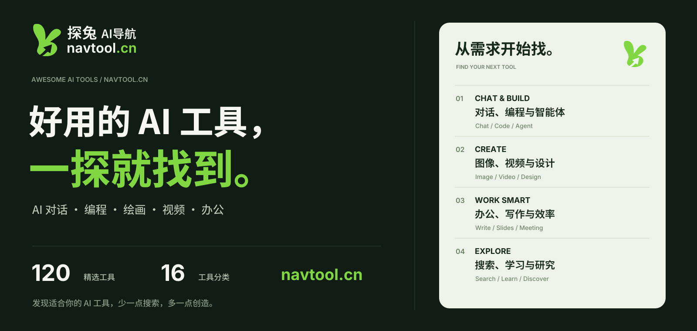
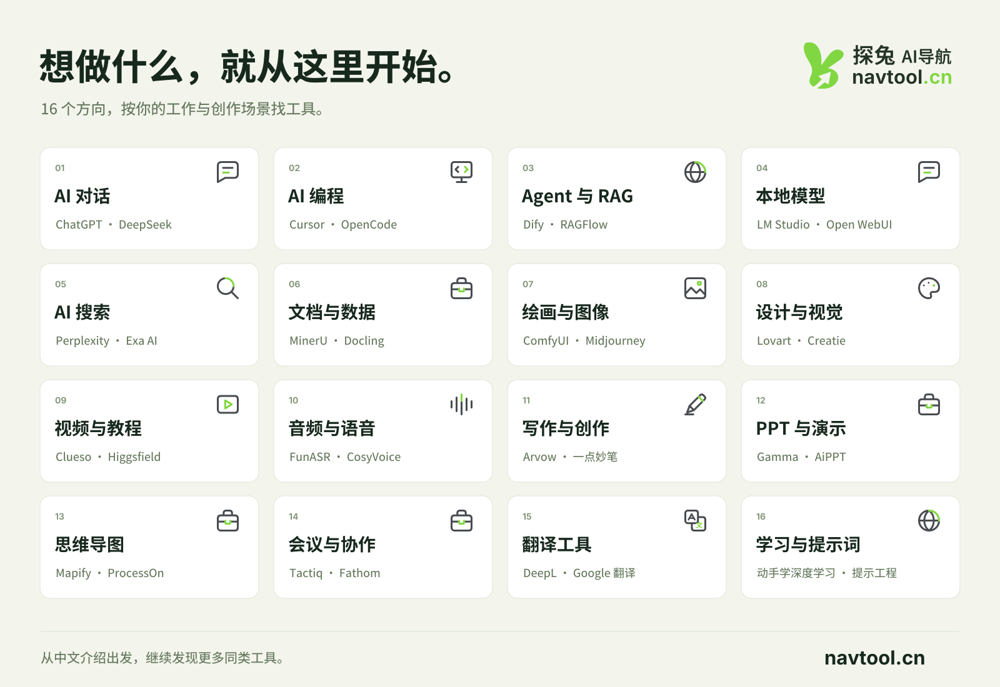
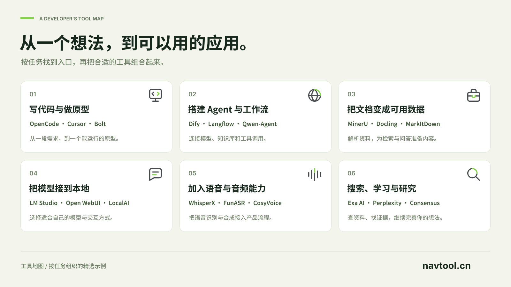

<h1 align="center">Awesome AI Tools</h1>

  <a href="https://www.navtool.cn/"><strong>探兔AI导航 · navtool.cn</strong></a>

好用的 AI 工具，一探就找到。

AI 对话 · 编程 · Agent · 绘画 · 视频 · 办公 · 学习

<strong>简体中文</strong> · <a href="README.en.md">English</a>

  
  
   
  
  

  <a href="https://www.navtool.cn/"><strong>在线浏览 →</strong></a>
   
  <a href="#start-here">快速开始</a> ·
  <a href="#directory">分类目录</a> ·
  <a href="CONTRIBUTING.md">参与维护</a>

**找 AI 工具，从你要做的事开始。**

这是 [探兔AI导航（navtool.cn）](https://www.navtool.cn/) 的公开精选清单，面向开发者、设计师、内容创作者和日常办公用户。每个工具都有一句话用途、探兔中文介绍页与直接访问入口。

**120 个精选工具 · 16 个分类 · 整理于 2026-10-19**

---

## 🐰 发现更多：探兔AI导航

想找同类工具、先读中文介绍，或按使用场景继续探索？打开 **[navtool.cn →](https://www.navtool.cn/)**。

| 你可以在探兔做什么 | 在线入口 |
| --- | --- |
| 按用途找工具，比较同一方向的选择 | [AI 编程](https://www.navtool.cn/tools/ai_programming_tools) · [AI 开发平台](https://www.navtool.cn/tools/ai_development_platform) |
| 为内容创作与日常办公找助手 | [AI 图像](https://www.navtool.cn/tools/ai_image_tools) · [AI 写作](https://www.navtool.cn/tools/ai_writer_tools) · [AI 办公](https://www.navtool.cn/tools/ai_office_tools) |
| 浏览站内资讯与工具榜单 | [AI 新闻资讯](https://www.navtool.cn/news) · [AI 排行榜](https://www.navtool.cn/rankings) |
| 推荐一个工具，或介绍自己的产品 | [投稿 AI 工具](https://www.navtool.cn/contribute) · [联系站长](https://www.navtool.cn/contact) |

> 收藏探兔：[navtool.cn](https://www.navtool.cn/) · Windows / Linux：`Ctrl + D` · Mac：`⌘ + D`

## ⭐ 快速开始

先挑一个任务，再从一两个工具开始。点击工具名称可查看探兔中文介绍。

| 我想做什么 | 可以从这些工具开始 | 继续探索 |
| --- | --- | --- |
| 日常问答与内容创作 | [ChatGPT](https://www.navtool.cn/tool/567.html) · [DeepSeek](https://www.navtool.cn/tool/565.html) | [AI 对话](#tools-chat) |
| 理解代码、修改项目 | [Cursor](https://www.navtool.cn/tool/807.html) · [OpenCode](https://www.navtool.cn/tool/2204.html) | [AI 编程](#tools-coding) |
| 搭建 Agent 或知识库 | [Dify](https://www.navtool.cn/tool/2106.html) · [RAGFlow](https://www.navtool.cn/tool/2094.html) | [Agent 与 RAG](#tools-agents) |
| 在电脑上体验本地模型 | [LM Studio](https://www.navtool.cn/tool/2077.html) · [Open WebUI](https://www.navtool.cn/tool/2064.html) | [本地模型](#tools-local-ai) |
| 制作图像与视觉素材 | [Midjourney](https://www.navtool.cn/tool/245.html) · [ComfyUI](https://www.navtool.cn/tool/2186.html) | [绘画与图像](#tools-image) |
| 准备演示与整理想法 | [Gamma](https://www.navtool.cn/tool/58.html) · [Mapify](https://www.navtool.cn/tool/114.html) | [PPT 与演示](#tools-slides) |

## 🗂️ 分类目录

点击分类跳转到本页。数字表示本仓库的精选条目数。

| 开发与模型 | 图像与内容 | 办公与协作 | 信息与学习 |
| --- | --- | --- | --- |
| [AI 对话](#tools-chat) 8 | [绘画与图像](#tools-image) 8 | [写作与创作](#tools-writing) 6 | [搜索与研究](#tools-search) 8 |
| [AI 编程](#tools-coding) 10 | [设计与视觉](#tools-design) 8 | [PPT 与演示](#tools-slides) 6 | [文档与数据](#tools-documents) 8 |
| [Agent 与 RAG](#tools-agents) 8 | [视频与教程](#tools-video) 8 | [思维导图](#tools-mindmap) 6 | [翻译工具](#tools-translation) 6 |
| [本地模型](#tools-local-ai) 8 | [音频与语音](#tools-audio) 10 | [会议与协作](#tools-meetings) 6 | [学习与提示词](#tools-learning) 6 |

展开查看 16 类工具概览

---

## 完整分类清单

工具名称 → 探兔中文介绍；右侧「访问」→ 产品或项目。各分类末尾可继续查看站内更多工具。

### 01. AI 对话与通用助手 (8)

问答、写作、资料整理，先找到一个顺手的 AI 助手。

| 工具 / 中文介绍 | 一句话用途 | 入口 |
| --- | --- | --- |
| [ChatGPT](https://www.navtool.cn/tool/567.html) | 通过对话进行问答、内容创作与资料分析 | [访问](https://chatgpt.com) |
| [DeepSeek](https://www.navtool.cn/tool/565.html) | 用于日常问答、推理与编程辅助 | [访问](https://www.deepseek.com) |
| [Kimi智能助手](https://www.navtool.cn/tool/633.html) | 围绕资料阅读、搜索与内容创作进行对话 | [访问](https://www.kimi.com) |
| [豆包](https://www.navtool.cn/tool/627.html) | 处理日常问答与多模态内容创作 | [访问](https://www.doubao.com/chat) |
| [通义千问](https://www.navtool.cn/tool/623.html) | 通过对话完成问答与内容生成 | [访问](https://tongyi.aliyun.com) |
| [腾讯元宝](https://www.navtool.cn/tool/625.html) | 结合对话和搜索辅助资料整理与创作 | [访问](https://yuanbao.tencent.com) |
| [讯飞星火](https://www.navtool.cn/tool/629.html) | 用于问答、内容生成与办公辅助 | [访问](https://xinghuo.xfyun.cn) |
| [Grok](https://www.navtool.cn/tool/605.html) | 进行信息问答、内容创作与对话 | [访问](https://grok.com) |

[探兔上的更多同类工具 →](https://www.navtool.cn/tools/ai_dialog_tools) · [返回目录 ↑](#directory)

### 02. AI 编程与应用构建 (10)

写代码、读项目、做原型，把需求推进到可运行的应用。

| 工具 / 中文介绍 | 一句话用途 | 入口 |
| --- | --- | --- |
| [OpenCode](https://www.navtool.cn/tool/2204.html) | 在终端和开发环境中处理编程任务 | [访问](https://opencode.ai) |
| [CodeBuddy（腾讯云代码助手）](https://www.navtool.cn/tool/2114.html) | 代码补全与开发任务协作 | [访问](https://www.codebuddy.cn) |
| [Cursor](https://www.navtool.cn/tool/807.html) | 在编辑器中理解、编写和修改代码 | [访问](https://cursor.com) |
| [Windsurf](https://www.navtool.cn/tool/845.html) | 结合 AI 助手的集成开发环境 | [访问](https://windsurf.com) |
| [Bolt](https://www.navtool.cn/tool/843.html) | 通过自然语言搭建网页应用 | [访问](https://bolt.new) |
| [Replit Agent](https://www.navtool.cn/tool/841.html) | 通过对话构建和迭代应用 | [访问](https://docs.replit.com/replitai/agent) |
| [Wegic](https://www.navtool.cn/tool/853.html) | 通过对话设计和搭建网站 | [访问](https://wegic.ai) |
| [BLACKBOX AI](https://www.navtool.cn/tool/847.html) | 辅助代码生成、理解与修改 | [访问](https://www.blackbox.ai) |
| [文心快码](https://www.navtool.cn/tool/849.html) | 辅助代码补全、理解与编程任务 | [访问](https://comate.baidu.com) |
| [CodeArts Snap](https://www.navtool.cn/tool/851.html) | 为开发过程提供智能编程辅助 | [访问](https://www.huaweicloud.com/product/codeartside/snap.html) |

[探兔上的更多同类工具 →](https://www.navtool.cn/tools/ai_programming_tools) · [返回目录 ↑](#directory)

### 03. Agent、工作流与 RAG (8)

把模型、文档、工具调用和业务步骤串成工作流。

| 工具 / 中文介绍 | 一句话用途 | 入口 |
| --- | --- | --- |
| [Dify](https://www.navtool.cn/tool/2106.html) | 搭建 AI 应用、工作流和知识库 | [访问](https://dify.ai) |
| [FastGPT](https://www.navtool.cn/tool/2090.html) | 搭建知识库问答与 AI 工作流 | [访问](https://fastgpt.cn) |
| [RAGFlow](https://www.navtool.cn/tool/2094.html) | 从文档构建检索增强生成应用 | [访问](https://ragflow.io) |
| [Langflow](https://www.navtool.cn/tool/2132.html) | 通过可视化组件编排 AI 应用 | [访问](https://www.langflow.org) |
| [Qwen-Agent](https://www.navtool.cn/tool/2183.html) | 构建支持工具调用的智能体 | [访问](https://github.com/QwenLM/Qwen-Agent) |
| [Relevance AI](https://www.navtool.cn/tool/2286.html) | 构建面向业务流程的 AI 智能体 | [访问](https://relevanceai.com) |
| [Lindy](https://www.navtool.cn/tool/2254.html) | 连接常用工作应用并编排自动化任务 | [访问](https://www.lindy.ai) |
| [DeerFlow](https://www.navtool.cn/tool/2216.html) | 探索研究、编程与内容任务的智能体框架 | [访问](https://deerflow.tech) |

[探兔上的更多同类工具 →](https://www.navtool.cn/tools/ai_development_platform) · [返回目录 ↑](#directory)

### 04. 本地模型与聊天客户端 (8)

从本地运行模型，到统一管理多个模型服务。

| 工具 / 中文介绍 | 一句话用途 | 入口 |
| --- | --- | --- |
| [LM Studio](https://www.navtool.cn/tool/2077.html) | 在桌面下载、运行和调用本地模型 | [访问](https://lmstudio.ai) |
| [GPT4All](https://www.navtool.cn/tool/2097.html) | 在本地运行对话模型与文档问答 | [访问](https://www.nomic.ai/gpt4all) |
| [Open WebUI](https://www.navtool.cn/tool/2064.html) | 搭建多模型对话与知识库网页工作台 | [访问](https://openwebui.com) |
| [AnythingLLM](https://www.navtool.cn/tool/2068.html) | 把文档接入 AI 助手和知识库 | [访问](https://anythingllm.com) |
| [Cherry Studio](https://www.navtool.cn/tool/2061.html) | 在桌面统一使用多个模型服务 | [访问](https://www.cherryai.com.cn) |
| [LocalAI](https://www.navtool.cn/tool/2152.html) | 为本地模型提供兼容常见应用的推理接口 | [访问](https://localai.io) |
| [KoboldCpp](https://www.navtool.cn/tool/2222.html) | 在本地运行 GGUF 模型并使用网页交互 | [访问](https://github.com/LostRuins/koboldcpp) |
| [Khoj](https://www.navtool.cn/tool/2149.html) | 围绕笔记与个人资料进行搜索和问答 | [访问](https://khoj.dev) |

[探兔上的更多同类工具 →](https://www.navtool.cn/tools/ai_dialog_tools) · [返回目录 ↑](#directory)

### 05. AI 搜索与研究 (8)

带着具体问题查资料、找线索，再回到原始来源核对。

| 工具 / 中文介绍 | 一句话用途 | 入口 |
| --- | --- | --- |
| [Perplexity](https://www.navtool.cn/tool/1167.html) | 结合 AI 问答进行信息搜索 | [访问](https://www.perplexity.ai) |
| [Exa AI](https://www.navtool.cn/tool/1183.html) | 为应用接入网页搜索与信息检索 | [访问](https://exa.ai) |
| [Consensus](https://www.navtool.cn/tool/1153.html) | 围绕科学文献查找研究信息 | [访问](https://consensus.app) |
| [Phind](https://www.navtool.cn/tool/1157.html) | 通过 AI 搜索与问答查找信息 | [访问](https://www.phind.com) |
| [Felo](https://www.navtool.cn/tool/1185.html) | 通过自然语言搜索与整理信息 | [访问](https://felo.ai/search) |
| [Genspark](https://www.navtool.cn/tool/1181.html) | 辅助信息检索、研究与内容整理 | [访问](https://www.genspark.ai) |
| [知乎直答](https://www.navtool.cn/tool/1165.html) | 通过问答查找与整理知识信息 | [访问](https://zhida.zhihu.com) |
| [Glean](https://www.navtool.cn/tool/1175.html) | 搜索与整合企业内部工作信息 | [访问](https://www.glean.com) |

[探兔上的更多同类工具 →](https://www.navtool.cn/tools/ai_se) · [返回目录 ↑](#directory)

### 06. 文档解析与数据处理 (8)

读文档、提取内容、处理数据，为知识管理和 RAG 准备资料。

| 工具 / 中文介绍 | 一句话用途 | 入口 |
| --- | --- | --- |
| [MinerU](https://www.navtool.cn/tool/2074.html) | 将文档解析为适合检索的结构化内容 | [访问](https://mineru.net) |
| [Docling](https://www.navtool.cn/tool/2120.html) | 将 PDF、Office 和扫描图像转换为结构化内容 | [访问](https://docling.ai) |
| [MarkItDown](https://www.navtool.cn/tool/2180.html) | 将常见文件转换为 Markdown | [访问](https://github.com/microsoft/markitdown) |
| [PaddleOCR（飞桨 OCR）](https://www.navtool.cn/tool/2129.html) | 识别图片和文档中的文字、表格与版面 | [访问](https://www.paddleocr.ai) |
| [办公小浣熊](https://www.navtool.cn/tool/1195.html) | 辅助处理与分析数据文件 | [访问](https://www.xiaohuanxiong.com) |
| [Gigasheet](https://www.navtool.cn/tool/1670.html) | 通过表格界面处理和分析数据 | [访问](https://www.gigasheet.com) |
| [Scribe](https://www.navtool.cn/tool/2443.html) | 把操作步骤整理为带截图的流程指南 | [访问](https://scribe.com) |
| [Open Notebook](https://www.navtool.cn/tool/2201.html) | 整理资料并进行带来源的研究问答 | [访问](https://www.open-notebook.ai) |

[探兔上的更多同类工具 →](https://www.navtool.cn/tools/ai_documentation_tool) · [返回目录 ↑](#directory)

### 07. AI 绘画与图像处理 (8)

从图像生成到编辑与商品图制作，为具体创作找入口。

| 工具 / 中文介绍 | 一句话用途 | 入口 |
| --- | --- | --- |
| [Stable Diffusion](https://www.navtool.cn/tool/249.html) | 探索文本到图像的生成模型与工具 | [访问](https://stability.ai) |
| [Midjourney](https://www.navtool.cn/tool/245.html) | 通过提示词创作图像 | [访问](https://www.midjourney.com) |
| [ComfyUI](https://www.navtool.cn/tool/2186.html) | 通过节点工作流组织图像与视频生成 | [访问](https://comfy.org) |
| [稿定AI](https://www.navtool.cn/tool/1786.html) | 辅助创意图像与设计素材制作 | [访问](https://www.gaoding.art) |
| [MoPNG设计助手](https://www.navtool.cn/tool/1843.html) | 处理图片背景、尺寸与图像编辑任务 | [访问](https://mopng.cn) |
| [PicDoc](https://www.navtool.cn/tool/1787.html) | 将文字内容转换为图表与视觉表达 | [访问](https://www.picdoc.cn) |
| [BeePOP](https://www.navtool.cn/tool/2016.html) | 围绕商品素材制作电商展示图 | [访问](https://beepop.net/) |
| [Imgkits](https://www.navtool.cn/tool/2334.html) | 通过在线工具进行图像编辑与处理 | [访问](https://imgkits.com) |

[探兔上的更多同类工具 →](https://www.navtool.cn/tools/ai_image_tools) · [返回目录 ↑](#directory)

### 08. AI 设计与视觉创作 (8)

为界面、品牌、信息图和 3D 设计寻找创作工具。

| 工具 / 中文介绍 | 一句话用途 | 入口 |
| --- | --- | --- |
| [Napkin AI](https://www.navtool.cn/tool/1951.html) | 将文字整理为图示与信息图 | [访问](https://www.napkin.ai) |
| [Creatie](https://www.navtool.cn/tool/964.html) | 辅助产品界面与视觉设计 | [访问](https://creatie.ai) |
| [Lovart](https://www.navtool.cn/tool/1677.html) | 通过 AI 辅助多种视觉设计任务 | [访问](https://www.lovart.ai) |
| [Framer AI](https://www.navtool.cn/tool/960.html) | 辅助网站页面设计与构建 | [访问](https://www.framer.com/ai) |
| [Spline AI](https://www.navtool.cn/tool/952.html) | 辅助 3D 场景与视觉设计 | [访问](https://spline.design/ai-generate) |
| [Looka](https://www.navtool.cn/tool/966.html) | 辅助 Logo 与品牌视觉设计 | [访问](https://looka.com) |
| [FigJam AI](https://www.navtool.cn/tool/950.html) | 在白板中辅助整理想法与协作内容 | [访问](https://www.figma.com/figjam/ai) |
| [Vizcom](https://www.navtool.cn/tool/958.html) | 把设计草图转化为视觉概念 | [访问](https://www.vizcom.com) |

[探兔上的更多同类工具 →](https://www.navtool.cn/tools/ai_design_tools) · [返回目录 ↑](#directory)

### 09. AI 视频与教程制作 (8)

从视觉内容创作到录屏教程、远程录制和视频理解。

| 工具 / 中文介绍 | 一句话用途 | 入口 |
| --- | --- | --- |
| [Clueso](https://www.navtool.cn/tool/2446.html) | 把录屏或资料整理为教程视频与文档 | [访问](https://www.clueso.io) |
| [Guidde](https://www.navtool.cn/tool/2399.html) | 把软件操作录制整理为分步视频教程 | [访问](https://www.guidde.com) |
| [Higgsfield AI](https://www.navtool.cn/tool/2397.html) | 进行 AI 图像、视频与视觉特效创作 | [访问](https://higgsfield.ai) |
| [LightX2V Studio](https://www.navtool.cn/tool/2266.html) | 通过创作工作流组织视频与数字人素材 | [访问](https://x2v.light-ai.top/) |
| [Riverside](https://www.navtool.cn/tool/2425.html) | 进行远程音视频录制与内容剪辑 | [访问](https://riverside.com) |
| [Twelve Labs](https://www.navtool.cn/tool/1949.html) | 为应用接入视频搜索、理解与分析 | [访问](https://www.twelvelabs.io) |
| [万兴喵影](https://www.navtool.cn/tool/1796.html) | 进行视频剪辑与内容制作 | [访问](https://miao.wondershare.cn) |
| [开拍](https://www.navtool.cn/tool/1596.html) | 辅助短视频创作与内容处理 | [访问](https://www.kaipai.com) |

[探兔上的更多同类工具 →](https://www.navtool.cn/tools/ai_video_tools) · [返回目录 ↑](#directory)

### 10. AI 音频与语音 (10)

语音转文字、声音合成、语音输入与音乐创作。

| 工具 / 中文介绍 | 一句话用途 | 入口 |
| --- | --- | --- |
| [WhisperX](https://www.navtool.cn/tool/2171.html) | 将语音转写并对齐到词级时间戳 | [访问](https://github.com/m-bain/whisperX) |
| [FunASR](https://www.navtool.cn/tool/2146.html) | 开发语音识别和流式转写应用 | [访问](https://www.funasr.com) |
| [SenseVoice](https://www.navtool.cn/tool/2198.html) | 识别多语言语音及音频事件 | [访问](https://github.com/QwenAudio/SenseVoice) |
| [CosyVoice](https://www.navtool.cn/tool/2230.html) | 开发多语言文本转语音与流式语音生成 | [访问](https://github.com/QwenAudio/CosyVoice) |
| [GPT-SoVITS](https://www.navtool.cn/tool/2233.html) | 探索语音合成与少样本声音复刻 | [访问](https://github.com/RVC-Boss/GPT-SoVITS) |
| [WhisperLive](https://www.navtool.cn/tool/2236.html) | 对麦克风、录音文件和音频流进行近实时转写 | [访问](https://github.com/collabora/WhisperLive) |
| [Wispr Flow](https://www.navtool.cn/tool/2395.html) | 通过语音输入生成可编辑文字 | [访问](https://wisprflow.ai) |
| [Krisp](https://www.navtool.cn/tool/2307.html) | 处理音频降噪、会议转写与摘要 | [访问](https://krisp.ai) |
| [Vapi](https://www.navtool.cn/tool/1950.html) | 为开发者提供语音智能体构建能力 | [访问](https://vapi.ai) |
| [Sonauto](https://www.navtool.cn/tool/1114.html) | 辅助音乐生成与音频创作 | [访问](https://sonauto.ai) |

[探兔上的更多同类工具 →](https://www.navtool.cn/tools/ai_audio_tools) · [返回目录 ↑](#directory)

### 11. AI 写作与内容创作 (6)

写文章、整理材料、起草方案，再由人核对与润色。

| 工具 / 中文介绍 | 一句话用途 | 入口 |
| --- | --- | --- |
| [Arvow](https://www.navtool.cn/tool/2046.html) | 辅助 SEO 文章创作与发布流程 | [访问](https://arvow.com) |
| [巧文书AI](https://www.navtool.cn/tool/1997.html) | 辅助方案与标书内容编写 | [访问](https://qiaowenshu.cn/index) |
| [一点妙笔](https://www.navtool.cn/tool/1981.html) | 辅助公文与工作材料写作 | [访问](https://www.1dmiaobi.com) |
| [材料星](https://www.navtool.cn/tool/1965.html) | 辅助职场材料创作、修改与排版 | [访问](https://www.cailiaoxing.com) |
| [公文宝](https://www.navtool.cn/tool/1762.html) | 辅助起草与整理公文内容 | [访问](https://www.gwb666.com) |
| [Copy2AI智能创作助手](https://www.navtool.cn/tool/1697.html) | 辅助多场景内容创作与批量生成 | [访问](https://www.copy2ai.com/creator.html) |

[探兔上的更多同类工具 →](https://www.navtool.cn/tools/ai_writer_tools) · [返回目录 ↑](#directory)

### 12. AI PPT 与演示 (6)

从大纲开始整理演示内容，减少排版和反复修改。

| 工具 / 中文介绍 | 一句话用途 | 入口 |
| --- | --- | --- |
| [Gamma](https://www.navtool.cn/tool/58.html) | 辅助生成与编辑演示内容 | [访问](https://gamma.app) |
| [AiPPT](https://www.navtool.cn/tool/1216.html) | 根据主题与资料生成演示文稿 | [访问](https://www.aippt.cn) |
| [WPS AI](https://www.navtool.cn/tool/1191.html) | 在办公流程中获得 AI 内容与文档辅助 | [访问](https://ai.wps.cn/) |
| [ChatPPT](https://www.navtool.cn/tool/1212.html) | 通过对话生成和调整演示文稿 | [访问](https://www.chat-ppt.com) |
| [beautiful.ai](https://www.navtool.cn/tool/84.html) | 通过智能模板组织演示文稿 | [访问](https://www.beautiful.ai) |
| [SlidesAI](https://www.navtool.cn/tool/63.html) | 辅助把内容整理为演示幻灯片 | [访问](https://www.slidesai.io) |

[探兔上的更多同类工具 →](https://www.navtool.cn/tools/ai_slides_and_presentations) · [返回目录 ↑](#directory)

### 13. AI 思维导图与白板 (6)

把零散想法、长文和会议内容整理成可视化结构。

| 工具 / 中文介绍 | 一句话用途 | 入口 |
| --- | --- | --- |
| [ProcessOn](https://www.navtool.cn/tool/1512.html) | 绘制流程图与思维导图 | [访问](https://www.processon.com) |
| [GitMind](https://www.navtool.cn/tool/1523.html) | 辅助创建与整理思维导图 | [访问](https://gitmind.cn) |
| [知犀AI](https://www.navtool.cn/tool/1521.html) | 根据主题辅助生成思维导图 | [访问](https://www.swdt.com) |
| [TreeMind树图](https://www.navtool.cn/tool/1508.html) | 把想法与文档整理为可编辑导图 | [访问](https://shutu.cn) |
| [Xmind Copilot](https://www.navtool.cn/tool/76.html) | 辅助拓展想法并整理思维结构 | [访问](https://app.xmind.com) |
| [Mapify](https://www.navtool.cn/tool/114.html) | 把文档、链接等内容总结为思维导图 | [访问](https://mapify.so) |

[探兔上的更多同类工具 →](https://www.navtool.cn/tools/ai_mind_map) · [返回目录 ↑](#directory)

### 14. AI 会议与工作协作 (6)

从会议转写到摘要和待办，让讨论留下可继续推进的记录。

| 工具 / 中文介绍 | 一句话用途 | 入口 |
| --- | --- | --- |
| [Tactiq](https://www.navtool.cn/tool/2423.html) | 转写在线会议并整理摘要与行动项 | [访问](https://tactiq.io) |
| [Fathom](https://www.navtool.cn/tool/2283.html) | 整理会议转写、摘要和行动项 | [访问](https://www.fathom.ai) |
| [tl;dv](https://www.navtool.cn/tool/2421.html) | 记录会议并整理转写与后续行动 | [访问](https://tldv.io) |
| [Granola](https://www.navtool.cn/tool/2304.html) | 结合个人笔记与会议转写生成摘要 | [访问](https://www.granola.ai) |
| [飞书妙记](https://www.navtool.cn/tool/78.html) | 整理音视频会议内容与纪要 | [访问](https://future.feishu.cn) |
| [Otter.ai](https://www.navtool.cn/tool/121.html) | 记录会议并生成转写与摘要 | [访问](https://otter.ai) |

[探兔上的更多同类工具 →](https://www.navtool.cn/tools/ai_meeting_tools) · [返回目录 ↑](#directory)

### 15. AI 翻译与语言工具 (6)

处理跨语言阅读、文档理解与日常表达。

| 工具 / 中文介绍 | 一句话用途 | 入口 |
| --- | --- | --- |
| [DeepL 翻译](https://www.navtool.cn/tool/641.html) | 翻译文本与文档中的跨语言内容 | [访问](https://www.deepl.com/en/translator) |
| [Google 翻译](https://www.navtool.cn/tool/639.html) | 进行文本、语音与图像翻译 | [访问](https://translate.google.com) |
| [百度翻译](https://www.navtool.cn/tool/656.html) | 辅助文本与多种内容形式的翻译 | [访问](https://fanyi.baidu.com) |
| [腾讯交互翻译](https://www.navtool.cn/tool/647.html) | 辅助文本翻译与交互式修改 | [访问](https://transmart.qq.com/zh-CN/index) |
| [火山翻译](https://www.navtool.cn/tool/658.html) | 辅助文本与文档翻译 | [访问](https://translate.volcengine.com) |
| [讯飞智能翻译](https://www.navtool.cn/tool/662.html) | 处理多语言文本与语音翻译 | [访问](https://fanyi.xfyun.cn) |

[探兔上的更多同类工具 →](https://www.navtool.cn/tools/ai_translation_tools) · [返回目录 ↑](#directory)

### 16. AI 学习与提示词资源 (6)

从基础概念到可运行的示例，为使用和开发 AI 补齐知识。

| 工具 / 中文介绍 | 一句话用途 | 入口 |
| --- | --- | --- |
| [动手学深度学习](https://www.navtool.cn/tool/997.html) | 通过代码、数学与实例学习深度学习 | [访问](https://zh.d2l.ai) |
| [提示工程指南](https://www.navtool.cn/tool/1354.html) | 学习提示词设计方法与应用示例 | [访问](https://www.promptingguide.ai/zh) |
| [ML for Beginners](https://www.navtool.cn/tool/987.html) | 通过课程与示例入门机器学习 | [访问](https://microsoft.github.io/ml-for-beginners) |
| [Generative AI for Beginners](https://www.navtool.cn/tool/974.html) | 通过课程与示例入门生成式 AI | [访问](https://microsoft.github.io/generative-ai-for-beginners/) |
| [DeepLearning.AI](https://www.navtool.cn/tool/985.html) | 学习 AI 与深度学习相关课程 | [访问](https://www.deeplearning.ai) |
| [Kaggle](https://www.navtool.cn/tool/976.html) | 通过数据集、竞赛与示例练习数据科学 | [访问](https://www.kaggle.com) |

[探兔上的更多同类工具 →](https://www.navtool.cn/tools/ai_learning_website) · [返回目录 ↑](#directory)

---

## 🛠️ 开发者资源

如果你想做自己的工具索引、资源搜索或团队选型表，也可以直接读取结构化数据。

[JSON 数据](data/tools.json) · [数据使用说明](docs/data-guide.md) · [独立完整清单](TOOLS.md)

展开查看开发者工具地图

## 🤝 参与维护

欢迎通过 **Issue 或 Pull Request** 推荐工具、修正失效链接、补充用途与标签。提交格式见 [贡献指南](CONTRIBUTING.md)。

希望产品出现在网站？请通过 [探兔投稿](https://www.navtool.cn/contribute) 提供入口、用途和访问条件。仓库与网站分别维护，PR 合并不会自动修改线上收录。

如果这份清单帮你找到一个有用的工具，欢迎 **Star 收藏**，也欢迎回来一起修正它。

## 常见问题

<strong>这些工具都免费吗？</strong>

清单包含在线服务、桌面工具、开发框架和学习资源。免费范围、试用额度、订阅与 API 费用各不相同，请以各工具当前说明为准。

<strong>为什么工具名称链接到探兔？</strong>

探兔介绍页提供中文用途说明和工具入口，方便先了解再选择。每行右侧保留直接访问产品或项目的链接。

<strong>英文版和中文版内容一样吗？</strong>

两个版本包含相同的 120 个工具、16 个分类与链接。英文版翻译了工具用途、导航和配图；探兔网站及工具介绍页目前以中文为主。

<strong>这是网站源码仓库吗？</strong>

当前公开内容为精选文档、JSON 数据与展示素材。线上网站的部署源码不在本次发布范围。

## 许可与说明

原创整理的文字与分类数据采用 [CC BY 4.0](LICENSE)。复用时请注明「探兔AI导航 / awesome-ai-tools-navtool」、链接到 [navtool.cn](https://www.navtool.cn/)，并说明修改。品牌素材范围见 [NOTICE.md](NOTICE.md)。

功能、定价、访问条件及第三方许可可能变化，请在使用前查看各工具自身说明。上传私有代码、商业文件或个人资料前，请先了解相应的数据处理方式。

---

<strong>简体中文</strong> · <a href="README.en.md">English</a> <a href="https://www.navtool.cn/">navtool.cn</a> · <a href="#top">↑ Top</a>

